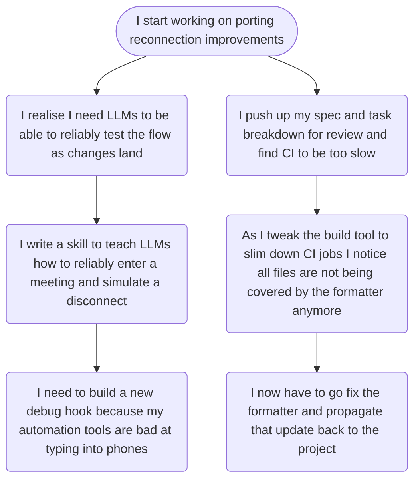

# Personal

Rather quiet week for me again which was mostly dominated by work stuff as you'll read below. It has also rained for most of the week which is making me a bit cranky even if I do welcome the cooler weather.

I had a rather surprising interaction over email when the author of [MacMD Viewer](https://macmdviewer.com/) reached out to offer a free licence after reading [about my Obsidian to week notes](/notes/collating-entries-in-my-obsidian-journal-for-week-notes/) setup. I accepted, but admittedly have not had much opportunity to test the tool yet. With Obsidian also gaining support for [standalone Markdown files and macOS Quick Look](https://obsidian.md/changelog/2026-10-05-desktop-v1.14.4/) very recently I fear there's not enough of a moat with this app for me to use it over Obsidian. I'm very evidently not being paid by the author≤≤

# Work

The new office finally opened this week after multiple delays, and I'd definitely say it was worth it. The new space is probably 3 times bigger than what we had, the layout is much more spacious, and the pantry stays stocked (if you see this Jyothi, I'm joking). The downside that we were already aware of was the fact that it's no longer Metro accessible. The gang decided to validate that by trying to walk to the closest Metro station, and were almost run over by vehicles only twice. Suffice to say we'll be availing our commuter benefits much more frequently.

I've been helping out with the [RealtimeKit](https://developers.cloudflare.com/realtime/realtimekit/) backend for the past couple of weeks as work on the mobile SDKs was in a bit of a lull. Unsurprisingly I broke something and got to hold the pieces; thankfully this was only to an internal observability system that didn't cause any customer facing impact. Thanks to debugging from the folks working full-time on the backend the bug was identified quickly, and I was able to submit a follow-up to resolve it. Learning experience and all that!

I saw a new opening in the DevTools team float by on the internal job board that was very tempting, but I'm still not sure if I want to apply and leave the RealtimeKit team. Things are going rather well here, and I still like being a mobile engineer. We'll see!

Speaking of changes at work, my promotion finally went through this week! I've been working towards this for a while now so it feels quite satisfying for this to finally be done. I also got a very hefty pay raise to go with it, since I was apparently near the bottom of my existing pay band 🙃

## Tangent about tangents

How do people cope with their work just decomposing into a series of tangents? This is a real breakdown of how I started working on a fundamental rearchitecture of the Mobile SDK's handling of reconnections (modelled after recent changes in the Web SDK) and ended up spending two days doing NONE of it.

Genuinely starts feeling like I've actually built nothing of value when the moment I touch it everything starts crumbling to dust. Maybe I'm just being dramatic and having big feelings for no-therapy-in-a-bit reasons. Onwards!

# Gaming

The gang was not jiving with Helldivers 2 this week so after a very boring run on Monday, I convinced Shreyansh and Prajwal to try [Crashout Crew](https://crashoutcrew.site/) which I had purchased some time ago. We gave it a go on Tuesday and were immediately hooked, a couple of hours went by in a flash. We roped in [Amogh](https://kat.bio) one of the days and unfortunately had to deal with the hell that is the bee/honey shipment. Absolutely couldn't get it done, got pissed and just went back to Helldivers 2 for a bit. There Prajwal ended up rage-quitting after being harassed by the clankers a little too much so that spelt the end of this week's friendslop adventures.

I continued making steady progress in CONTROL: Resonant this week. Did a few side missions to level up my build, then I ventured further into the Underpass section and got my ass beat a few times by the Resonant there. Was tantalizingly close to beating it on my last run, got it down to around 15% of its health, but I'm just fully expecting there to be a phase 2 to this nonsense. The game remains incredibly fun despite the constant skill issue :D

# Personal projects

I put out another release of [Claw](https://github.com/msfjarvis/compose-lobsters/) with a few minor fixes to the UI and a crash fix for a rare bug in the new HTML renderer I had shipped last week.

## 🤖 CLANK CLANK CLANK 🤖
